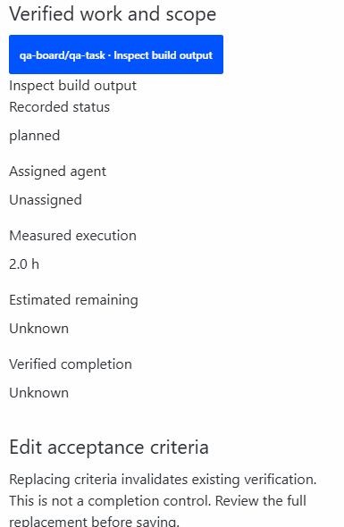
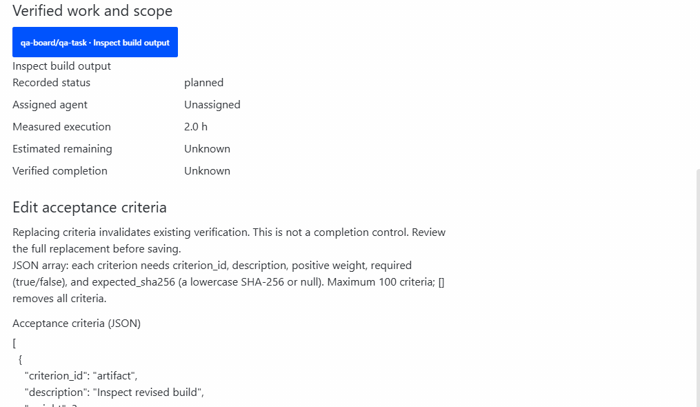

# Hermes Desktop page

The plugin ships one unified package: the Python engine, a scoped REST adapter at
`dashboard/plugin_api.py`, and a native renderer at `desktop/plugin.js` built on
`@hermes/plugin-sdk`. Enabling the plugin in Hermes Desktop adds an **Urgency Engine**
sidebar entry, a command-palette entry, and a status-bar button, all opening `/urgency`.
The status bar shares the first unfiltered portfolio query with the page. It shows the
highest backend urgency among recorded active commitments only when that measurement
page is complete, otherwise `partial coverage`. Loading, failed reads and disconnected
gateways are labeled instead of retaining a seemingly current risk. Unconfigured
canonical projects are not included in this recorded-Ledger risk summary.

- [Reference: routes, controls and settings](#reference)
- [Explanation: what the page can and cannot tell you](#explanation)
- [How to install, manage commitments and recover](#how-to)
- [Tutorial: build a synthetic project and watch it slip](#tutorial)
- [Acceptance matrix for the 16 required scenarios](#acceptance-matrix)

## Reference

### Read routes

Every route lives under `/api/plugins/hermes-urgency-engine` and is reached through
`ctx.rest`, so Hermes authenticates the request and selects the profile before the
adapter sees it. The adapter accepts no path, home, actor or authorization field: a
payload cannot choose a database or claim a permission. Responses are
`{"ok": true, "data": ...}` or an error envelope carrying `code`, `operation`,
`retryable`, `side_effects` and `next_action`.

| Route | Query | Returns |
|---|---|---|
| `GET /identity` | — | `scope_id`: opaque 32-character namespace, or `null` before explicit initialization; never creates storage |
| `GET /portfolio` | `limit` (1-500, default 100), `after`, `board`, `project`, `assignee`, `urgency` (0-6), `deadline_type` (`hard`/`soft`) | `items`, `next`, `has_more`, `scanned`, `coordination`, `observed_at`, `coverage` |
| `GET /projects/{project_id}` | — | project, `progress`, `summary`, `commitments`, `commitments_has_more`, `urgency`, `risk_coverage`, `observed_at`, `coverage` |
| `GET /projects/{project_id}/commitments` | `limit`, `after` (deadline ID) | paged deadline explanations, `has_more`, `next`, `project_revision`, `observed_at` |
| `GET /projects/{project_id}/timeline` | `start`, `end` (UTC ISO 8601, span 0 to 366 days), `limit`, `after` | paged task rows with `started_at`, `dependencies` and `blocked_periods` explicitly `null`, plus `start`, `end`, `now`, `range_policy` |
| `GET /projects/{project_id}/milestones` | `limit`, `after` | `items`, `has_more`, `next` |
| `GET /projects/{project_id}/milestones/{milestone_id}` | — | scoped milestone title, member task IDs and owning `project_revision` |
| `GET /projects/{project_id}/history` | `limit`, `after` (decimal sequence) | project and member task/milestone/deadline audit records, `has_more`, `next` |
| `GET /projects/{project_id}/source-tasks` | `limit`, `after` | canonical Sync rows plus `sync_health` and `sync_seconds` |
| `GET /projects/{project_id}/interventions` | `limit`, `after` | receipts, `recovery_creation`, `next_action` |

An unknown query parameter, a repeated parameter, a non-decimal `limit`, or a limit
outside 1-500 is `INVALID_INPUT` (400). An unknown project is `NOT_FOUND` (404). A
stale revision is `REVISION_CONFLICT` (409). An unavailable capability is 503 with a
stable code. An unexpected failure is 500 carrying a `diagnostic_id` and no traceback.

### Write route

`POST /identity` explicitly initializes an opaque profile namespace in the plugin's
`desktop.db` metadata store and returns the same identity on later calls. It uses
the host authentication, operator-only and stop fences; no worker gains permission.
It accepts no domain arguments and changes no Ledger data.

`POST /commands` takes `{"request_id", "operation", "arguments"}` with an optional
`scope_id` (32 lowercase hexadecimal characters); all other envelope fields are
refused. The renderer includes the namespace and the backend compares it with the
current authenticated profile before opening the Ledger writer. A mismatch is
`SOURCE_DENIED` with field `scope_id`. This is a routing safeguard, not authority.
The body is bounded by the host's `MAX_INPUT_BYTES` and refused
before an oversized chunk is retained. The allowlist is exactly:

| Operation | Required arguments | Revision checked against |
|---|---|---|
| `create_project` | `project_id`, `title` | — |
| `edit_project` | `project_id`, `title`, `expected_revision`, `reason` | the project |
| `create_milestone` | `milestone_id`, `project_id`, `title` | — |
| `edit_milestone` | `milestone_id`, `title`, `expected_revision`, `reason` | **the owning project** |
| `set_milestone_tasks` | `milestone_id`, `tasks`, `expected_revision`, `reason` | **the owning project** |
| `set_deadline` | `deadline_id`, `project_id`, `kind`, `at`, `timezone`, `owner`, `source` (optional `board_id`/`task_id`/`milestone_id`) | — |
| `revise_deadline` | `deadline_id`, `at`, `timezone`, `expected_revision`, `reason` | the deadline |
| `baseline_scope` | `project_id`, `expected_revision`, `reason` | the project |
| `set_criteria` | `board_id`, `task_id`, `criteria`, `expected_revision`, `reason` | the task |

A milestone row carries no revision column of its own, so milestone title and
membership edits submit the **project** revision. The page's controls do this for you.

Deadline controls submit civil time (`YYYY-MM-DDTHH:MM:SS`) plus an IANA zone.
The backend resolves it to an offset timestamp only when that civil time names one
instant. Nonexistent spring-forward times and ambiguous fall-back times are refused;
choose another time or use the CLI with an explicit offset. Existing offset-bearing
API inputs still undergo the Ledger's offset/zone consistency checks.

`revise_deadline` always runs with `intent: "operator"`, injected by the adapter. The
renderer cannot send an intent, so the page can never present itself as an automatic
reschedule. `verify_artifact`, `claim_complete`, `reopen_task`, `upsert_task` and
`snapshot_forecast` are **not** exposed over HTTP; use the supported CLI for those.

### Controls on the page

Portfolio: a project table with measurement binding, weighted verified progress,
engine urgency, schedule status and next outstanding commitment. Expand **Execution
and forecast** for recorded task-state counts, assigned/running agent names, a
project-scoped forecast and its evidence class, hard deadline, next milestone and
last verified progress. Running Ledger state is not live worker liveness. Board and
agent name lists cap at 100 with a partial indicator; counts cover all recorded tasks.
The next commitment is chosen by target time, not ID order. A summary with more than
100 commitments has unknown aggregate risk, next dates and forecast. A project
forecast requires a project-scoped commitment, not a guess from one milestone.

Use Board ID, Project ID, Assigned agent, Urgency and Deadline type filters, then
**Apply filters**. Filters are exact matches on recorded Ledger data. Urgency 0 means
unmeasured, including partial risk. Each request scans at most `limit` project rows;
an empty filtered page can still have a next cursor. Use **Next projects** to keep
looking. **Clear filters** restores canonical unmeasured rows. Unmeasured projects
cannot match agent, urgency or deadline filters. The canonical inventory has its own
100-row display pages. Sort by urgency, name or next commitment within the loaded
display page; sorting never changes backend state.

The portfolio timeline shows hard deadlines and milestone targets from loaded
project/commitment pages, 100 at a time. Selecting a marker opens its project. The
backend highlights shared assigned agents and targets on the same UTC day among
the loaded projects, capped at 100 groups. These are potential contention, not a
capacity-violation claim; no capacity budget is inferred. Off-page commitments and
assignments can reveal additional contention. Detail: progress, risk and its reasons,
weighted scope against the baseline, the
commitment timeline with `6h / 24h / 7d / 30d / 90d` presets, zoom, Earlier/Later and
Fit controls, and tabs for Commitments, Milestones, Verified work, Source tasks,
History and Interventions. Commitment pages have First/Next controls; Fit covers
the loaded page, with a maximum 366-day axis. Forms: create and
edit project, add a deadline, reschedule a deadline, add a milestone, and edit
milestone title and membership. Both editors first load the existing record, so
opening membership never starts with an empty replacement for existing members.

Verified work pages measured tasks and opens their goal, agent, recorded execution
duration, remaining estimate, completion timestamp and criteria. **Acceptance evidence**
lists each current criterion's description, weight, required flag and verified-byte
state. Expand it for the receipt ID, check time and expected/observed SHA-256. No
artifact path or file content is returned. Reopened or replaced criteria lose credit;
invalidated receipts are not shown as current evidence. The criteria editor
uses a labelled JSON array, preloaded with the complete current criteria. Replacing
criteria invalidates previous verification; it cannot mark work complete. Record
original scope creates the immutable weighted baseline once, with a required reason.
Source tasks separately shows canonical dependencies and the latest recorded run's
start/end/heartbeat with source freshness. A missing end does not establish completion.
Interventions uses the actual requested/observed effect and attribution fields;
matching requested and observed values alone never implies an attributed effect.

Hard and soft deadlines are labelled in text (`Hard (external commitment)`,
`Soft (internal target)`), never by colour alone. Timeline markers are `│` original,
`◆` hard target, `●` soft target, `◇` forecast, `■` actual completion, `↓` current
time, each with an accessible label and a 44px target on a separate vertical track.
Coincident dates remain separately selectable. Dragging never reschedules
anything; rescheduling is an explicit form with a required reason.

### Settings and cadence

The page polls every 10 seconds while visible and backs off to 60 seconds after a
failed read; the canonical inventory refreshes every 30 seconds. Reads stop while
the gateway is disconnected. Host events only mark the scoped cache stale (at most
once per five seconds); they never bypass the polling cadence or supply data.
`ctx.socket` is a no-op on OAuth remotes,
so polling is the floor, not an optimisation. The canonical Kanban sync cadence is
separate and is displayed on the Source tasks tab.

Queries are keyed by connection identity, activation epoch, profile and route. A read
that returns after the scope changed is discarded, and switching connection or
profile clears the view rather than re-labelling old rows.

## Explanation

### What "verified progress" means, and what it does not

Progress is `100 × verified weight / current scope weight`, computed by the Ledger
and never by the renderer. Weight becomes verified only when a criterion's recorded
`expected_sha256` matches an artifact's observed bytes. Consequences worth
internalising:

- An agent claiming completion moves nothing. `claim_complete` is not evidence.
- A project cannot read 100% while any task has no active criteria; it reports
  **Insufficient evidence** instead of a number, because an unscoped task means the
  denominator is unknown, not zero.
- Reopening a task or changing its criteria invalidates the matching evidence and
  removes the credit, so historical progress cannot be quietly inflated.
- **Byte identity is not semantic acceptance.** A file whose hash matches proves a
  specific artifact exists. It does not prove the work is correct, reviewed or useful.
  The page says so on every read. Treat the bar as "the recorded evidence is present",
  not "the deliverable is good".

### Three separate dates

A commitment keeps the **original** target (immutable), the **current** target (moved
only by an audited revision with a reason), and a **forecast** derived from remaining
work, verification and deployment time. The forecast never writes the target: a
slipping forecast is visible as a `◇` to the right of `◆`, and the `◆` stays put until
a human moves it. Hard deadlines additionally refuse an automatic revision outright,
so nothing in the engine can extend an external commitment.

A forecast is absent, not optimistic, when any contributing task has no remaining
estimate. The page prints `Unknown` rather than inventing a bar endpoint.

### Scope: what the page can see

Two independent inventories are joined:

1. **Canonical projects** from the host's own `projects.list` RPC for the selected
   profile. These are the projects Hermes knows about.
2. **Measured projects** from this plugin's Ledger for the selected Hermes home.

A measurement is attached to a canonical project **only when the Ledger project id is
exactly that canonical project's id**. Matching by name, slug, board or path is never
performed, because two projects can share all of those across scopes while being
different projects. The consequences are shown honestly:

- `Measured` — bound, with real numbers.
- `Not configured for urgency measurement` — a canonical project with no Ledger
  project of that id in a complete measurement inventory. Create one with the matching
  id to start measuring it. With paged measurements the label is instead
  `Measurement not loaded on this page`; absence from one page proves nothing.
- `No canonical project in this scope` — a Ledger project with no canonical peer
  here. Usually a different profile, a renamed project, or a local-only id.

If the inventory RPC fails, the page says the inventory is **unavailable** and lists
only measured projects. That is deliberately distinguished from an empty inventory: an
empty success and a failed read must never look alike.
Rows without a canonical match during a failed inventory read say
`Canonical inventory unavailable`, not that the canonical project is absent.

`coverage` is reported as `local_ledger_only` on every read, and project risk is
`partial` once more than 100 commitments exist, because the summary then reflects only
the first page. A partial measurement is never presented as a complete one.

### Why the renderer is thin

All arithmetic, policy and authorisation live in the Python engine. The renderer
registers UI, reads scoped routes and submits named commands. This is why a frontend
bug cannot invent progress, and why the CLI and the page can never disagree: there is
one implementation of the rules. The renderer imports only `@hermes/plugin-sdk`,
`react` and `react/jsx-runtime`; the test harness fails the build on any other import.

## How to

### Install the Desktop page

```bash
hermes plugins install DeliciousHouse/hermes-urgency-engine --ref <commit-sha> --enable
```

Then, in Hermes Desktop: **Capabilities → Plugins → Rescan**, search `urgency`, and
enable **Urgency Engine**. The sidebar entry appears immediately; `Ctrl+K` →
**Open Urgency Engine** also navigates to it. The Python half must be enabled in
`config.yaml` (`plugins.enabled`) for the REST routes to mount; the in-app toggle and
the config entry are separate switches.

Verify it is live: the header shows the selected connection and profile, and the
coverage line shows an `observed_at` timestamp that advances as you watch.
Before the first edit, choose **Enable command recovery**. This explicit action
creates only the opaque profile namespace; reading the page never initializes it.
If initialization is denied, use the existing operator session, not a worker-launched
backend with its fences removed.

### Record a hard deadline

1. Open the project from the portfolio.
2. Expand **Add a deadline**.
3. Enter a deadline ID, choose `Hard (external commitment)`, set the target date and
   time, name the time zone, and record the owner and source. Owner and source are
   domain facts for the audit trail; they grant no permission.
4. Save. The timeline shows `│` and `◆` at the same instant, because the original and
   the current target start equal.

### Reschedule a soft target without losing the baseline

1. In the Commitments tab, select **Reschedule this deadline** on the commitment.
2. The form shows the original and current target before any field you can edit.
3. Enter the new date, the time zone, and a reason. The reason is required.
4. Save. `│` stays at the original instant, `●` moves, and the History tab gains a
   record naming the actor, the reason and both revisions.

Accumulated slippage is readable at any time as **Variance against original** on each
commitment.

### Bind milestone membership and see risk change

1. Add a milestone, then open **Edit milestone membership**.
2. Name the milestone, list its member tasks one `board_id/task_id` per line, and give
   a reason. Only the first `/` splits a line, so a task id may contain one. A line
   that does not name both halves is refused by name before anything is sent, rather
   than guessed at.
3. Wait for the existing name and membership to load. Edit either form, then save
   and return to Commitments. A milestone-scoped deadline now measures exactly
   those tasks, so binding work that cannot finish in time raises the urgency level
   while leaving the committed target untouched.

### How to inspect and change weighted scope

1. Open **Verified work**, page to a measured task, and select its board/task button.
2. Review its recorded state and estimates. Edit the preloaded acceptance-criteria
   JSON array, preserving each criterion you intend to keep. Use `null` for an unknown
   expected digest; never invent an expected hash to obtain credit.
3. Enter a reason and choose **Replace criteria and invalidate verification**.
   Reloaded progress must lose any evidence invalidated by this change. Use the
   supported CLI to verify an actual artifact; this page cannot assert verification.
4. To capture the original project denominator, enter a baseline reason and choose
   **Record immutable baseline**. This succeeds once. A later attempt with a new
   request is refused rather than replacing history.

A stale task revision refuses the write. Read the current values before using the
explicit current-revision control. Invalid JSON is refused inline; invalid criterion
fields are refused by the Ledger without changing scope.

### Recover from a save whose result you never saw

If the reply is lost, the page keeps the **exact original request** and refuses to
start another one. It never retries with a fresh `request_id`, because that would risk
a second effect. Do this:

1. Read the current state (the page refetches, or use `hermes urgency` on the CLI) and
   decide whether the change actually landed.
2. If it did not, press **Reconcile same request**. The identical payload is replayed
   and the Ledger's idempotency rules make a duplicate a no-op rather than a second
   mutation.
3. If the revision moved under you, the save returns 409. A structured backend
   refusal with `side_effects: none` releases that failed request; a transport error
   without that receipt does not. Your draft and its original revision stay pinned
   through background refresh. Once the current record arrives, choose **Use current
   revision and keep draft**, review your changes, and save deliberately. This
   explicit action keeps dirty fields and adopts current values for untouched fields.

Project, deadline and milestone-membership edits keep their component identity across
background revisions. Failed measurement reads disable management controls until a
successful read. Submitted requests are persisted through the SDK's plugin storage
before transmission and restored without sending anything after a page reload.
Inspect **Retained command**, then explicitly choose **Reconcile retained command**.
The current authenticated route, profile, backend namespace and exact stored payload
are checked again before replay with the original request ID. Successful readback or
a structured no-effect refusal clears the record; a scope-identity refusal never
resolves the outcome in the original scope.

The namespace is not a credential. Known gateway identity and profile must also match,
so copying a backend store to another known gateway does not permit replay there.
For a connection without a stable gateway identity, recovery is allowed only within
the original renderer activation. After switching or restarting, its retained request
stays unapplied because the route is ambiguous; inspect the original backend via its
supported CLI rather than guessing a destination. No automatic resend occurs on activation.
Submitted fields remain in app-level local plugin storage until resolved. Do not
enter secrets in management fields. Disabling the UI preserves pending records and
backend metadata; removing Desktop app storage loses those local records, not Ledger
receipts. A native Web Lock allows one writable Urgency page per scope in the same
Desktop browser storage partition. Other windows remain readable. Close the owning
page, then choose **Try management in this window** to acquire the lock and reload
any outstanding intent before editing. Closing a page while its reply is unresolved
preserves that intent for explicit reconciliation. Hosts without Web Locks remain
read-only. Separate app installations do not share this UI lock; Ledger revisions
and request IDs continue to protect mutations across clients.

### Act on a risk the page cannot fix

The Interventions tab shows requested, observed and attributed effects. Recovery-card
creation reports `CAPABILITY_UNAVAILABLE` because the installed host exposes no
supported route for it; the tab names the supported CLI action instead. The page will
never report a recovery it did not perform.

## Tutorial

Build a synthetic project, watch it slip, and keep the baseline. Everything here is
invented data in a temporary directory; nothing touches a real board. Save as
`desktop_tutorial.py` inside a checkout and run it with the plugin's Python.

```python
"""Synthetic Desktop read-model walkthrough. No real project data."""
from datetime import datetime, timedelta, timezone
import hashlib, sqlite3, tempfile
from pathlib import Path

from urgency_engine.desktop import Views
from urgency_engine.ledger import Ledger

root = Path(tempfile.mkdtemp())
now = datetime(2030, 1, 1, tzinfo=timezone.utc)
clock = lambda: now
ledger = Ledger(sqlite3.connect(root / 'data.db'), clock=clock, artifact_root=root)

ledger.create_project('demo', 'Synthetic launch', request_id='p1', actor='operator')
ledger.upsert_task('demo-board', 'build', project_id='demo', goal='Build the thing',
                   expected_revision=0, reason='Plan', request_id='t1',
                   actor='operator', remaining_seconds=20 * 86400)
digest = hashlib.sha256(b'artifact bytes').hexdigest()
ledger.set_criteria('demo-board', 'build',
                    [dict(criterion_id='bundle', description='Shipped bundle',
                          weight=4, required=True, expected_sha256=digest)],
                    expected_revision=ledger.get_task('demo-board', 'build')['revision'],
                    reason='Scope', request_id='c1', actor='operator')
ledger.set_deadline('launch', project_id='demo', kind='hard',
                    at='2030-01-10T00:00:00Z', timezone='UTC', owner='Client',
                    source='Signed contract', request_id='d1', actor='operator')

view = Views(ledger, clock=clock)
first = view.project('demo')
print('progress        :', first['progress']['percent'], '(0 means no evidence yet)')
print('urgency         :', first['urgency']['level'], first['urgency']['reasons'])
print('original/target :', first['commitments'][0]['original_at'],
      first['commitments'][0]['target_at'])
print('forecast        :', first['commitments'][0]['forecast_at'],
      '<- 20 days of work against a 9 day target')

# A claim alone earns nothing.
ledger.claim_complete('demo-board', 'build',
                      expected_revision=ledger.get_task('demo-board', 'build')['revision'],
                      reason='Agent says done', request_id='claim1', actor='worker')
print('after claim     :', view.project('demo')['progress']['percent'], '(still 0)')

# Matching bytes do earn credit.
(root / 'bundle.bin').write_bytes(b'artifact bytes')
ledger.verify_artifact('demo-board', 'build', 'bundle', 'bundle.bin',
                       expected_revision=ledger.get_task('demo-board', 'build')['revision'],
                       reason='Bytes match', request_id='v1', actor='operator')
print('after evidence  :', view.project('demo')['progress']['percent'])

# An automatic extension of a hard deadline is refused outright.
try:
    ledger.revise_deadline('launch', at='2030-02-01T00:00:00Z', timezone='UTC',
                           intent='automatic', expected_revision=1,
                           reason='Forecast slipped', request_id='auto1', actor='engine')
except Exception as error:
    print('automatic move  : refused ->', error.code)

# An authorized operator move is audited and keeps the original.
ledger.revise_deadline('launch', at='2030-02-01T00:00:00Z', timezone='UTC',
                       intent='operator', expected_revision=1,
                       reason='Client agreed a new date', request_id='manual1',
                       actor='operator')
moved = view.project('demo')['commitments'][0]
print('original kept   :', moved['original_at'])
print('target moved    :', moved['target_at'])
print('variance (s)    :', moved['baseline_variance_seconds'])
print('audit reasons   :', [r['reason'] for r in ledger.history('deadline', 'launch')])
```

Output from an actual run of the script above:

```
progress        : 0.0 (0 means no evidence yet)
urgency         : 4 ['Insufficient evidence (0/5 samples); using estimated work (1.728e+06 s).', 'Risk slack: -950400 s after 0 s verification and 0 s deployment buffers.']
original/target : 2030-01-10T00:00:00+00:00 2030-01-10T00:00:00+00:00
forecast        : 2030-01-21T00:00:00+00:00 <- 20 days of work against a 9 day target
after claim     : 0.0 (still 0)
after evidence  : 100.0
automatic move  : refused -> INVALID_INPUT
original kept   : 2030-01-10T00:00:00+00:00
target moved    : 2030-02-01T00:00:00+00:00
variance (s)    : -777600.0
audit reasons   : ['', 'Client agreed a new date']
```

Three details in that output are worth reading carefully:

- Urgency is level 4 (**Critical**), not the maximum, and it says why: there is no
  historical sample set, so the estimate is used, and the risk slack is negative. The
  engine reports which inputs it had, rather than asserting a confident level.
- The baseline variance is **negative** (-777,600 s = 9 days) because the artifact was
  verified on 1 January against an original target of 10 January. Variance compares
  the verified completion with the commitment, so early delivery is negative.
- The first audit reason is empty because `set_deadline` records a creation, which
  takes no reason; only revisions require one.

The same values appear on the Desktop page: the progress bar reads the `progress`
field, the timeline draws `original_at`, `target_at` and `forecast_at` as separate
markers, and the History tab lists the reasons.

## Acceptance matrix

The amendment requires sixteen scenarios. Author automation is listed here with what
it does and does not establish. **Independent installed Desktop QA is still required
and is not satisfied by this table.**

| # | Scenario | Author evidence | Status |
|---|---|---|---|
| 1 | Progress changes when work is verified | `test_desktop_views.py::test_paged_portfolio_reads_real_progress_without_crediting_claims`; tutorial above | Automated |
| 2 | Percentages cannot reach 100% on claims alone | same test (`claim_complete` leaves 0); `desktop.test.mjs` progress test renders only backend values | Automated |
| 3 | Reopened tasks and scope changes handled | same test (reopen returns the project to 0) | Automated |
| 4 | Multiple projects update independently | same test (project `b` stays indeterminate while `a` reaches 100) | Automated |
| 5 | Changes made outside the dashboard appear | `desktop.test.mjs` scoped-read and invalidation tests; operator observed an external rename appearing in 5.28 s and 3.12 s on two independent native runs | Automated plus independent native observation |
| 6 | Hard deadlines never move automatically | `test_desktop_acceptance.py::test_case_6_hard_deadline_never_moves_automatically` | Automated |
| 7 | Soft deadlines retain original baselines | `test_desktop_views.py::test_commitments_expose_independent_forecasts_and_preserved_targets` | Automated |
| 8 | Forecasts update without changing commitments | same test (`forecast_at` moves, `target_at` does not, no snapshot is written) | Automated |
| 9 | Membership changes recalculate schedule risk | `test_desktop_acceptance.py::test_case_9_milestone_membership_change_recalculates_risk` | Automated |
| 10 | Escalation changes the displayed urgency level | `test_desktop_acceptance.py::test_case_10_escalation_changes_the_displayed_urgency_level` | Automated |
| 11 | Long-running work represented accurately | `test_desktop_acceptance.py::test_case_11_long_running_and_unestimated_work_is_not_invented` | Automated |
| 12 | Live updates recover after disconnection | `desktop.test.mjs` rejects results from a changed activation epoch; the page backs off to 60 s and resumes at 10 s | Automated at the module boundary only; real remote recovery is not proven here |
| 13 | Multiple profiles and remote connections isolated | queries keyed by connection, epoch and profile; `test_desktop_views.py` scope tests; `mergeInventory` refuses a same-named project from another scope | Automated at the module boundary; **host routing across two live gateways is NOT proven by the author** |
| 14 | Large task boards remain responsive | `test_desktop_acceptance.py::test_case_14_large_board_detail_stays_bounded_and_paged` (10,000 tasks, bounded pages, printed timing) | Automated; one machine, not a latency guarantee |
| 15 | Dark/light themes, resizing, keyboard navigation | operator inspected 620 px light and dark captures of the installed page; the renderer uses host theme variables, 44 px targets, visible focus rings and a 640 px responsive breakpoint | Partly independent; **full keyboard and theme QA is downstream** |
| 16 | Clean installation exposes the page without source edits | CI installs the exact public revision into a clean home, asserts the installed tree matches the published SHA with no diff, and exercises the native Desktop routes; operator loaded the whole package in the real Electron build and reached the page through Rescan, the sidebar and `Ctrl+K` | Automated plus independent native observation at pre-publication candidates |

Author testing is not independent QA. Cases 12, 13 and 15 are the weakest: they are
proven at the module boundary and by operator spot checks, not by a full matrix of
live remote gateways, assistive technology and window geometries.

### Synthetic native Desktop captures

These are crops of the upper **Verified work and scope** pane from a real installed
Hermes Desktop at source `45cfb2489043cf15a2ed9d0786fc224e58c8def8`, not HTML mocks.
The fixture uses synthetic `qa-board/qa-task` data. The lower criteria editor and
save controls are outside these crops. They illustrate this pane only, not current
recovery controls or completion of the sixteen-scenario acceptance matrix.





### Known gaps in this release

- **Current portfolio controls still need native captures and acceptance.** The
  scoped screenshots above do not establish these newer interactions. Recovery and
  single-writer handoff have scoped native operator evidence, not full release QA.
- **Portfolio coordination covers loaded pages only.** Shared assignments and
  same-day targets do not establish actual resource overload. The full dependency
  graph and capacity-aware planning overlay are still unfinished.
- **Task intervals, dependencies, blocked periods and critical path are reported as
  `null`,** not computed. The timeline is commitment-based; the task read model
  deliberately returns explicit nulls rather than invented execution periods.
- **Recovery-card creation remains unavailable** (`CAPABILITY_UNAVAILABLE`) because
  the installed host exposes no supported route for it.
